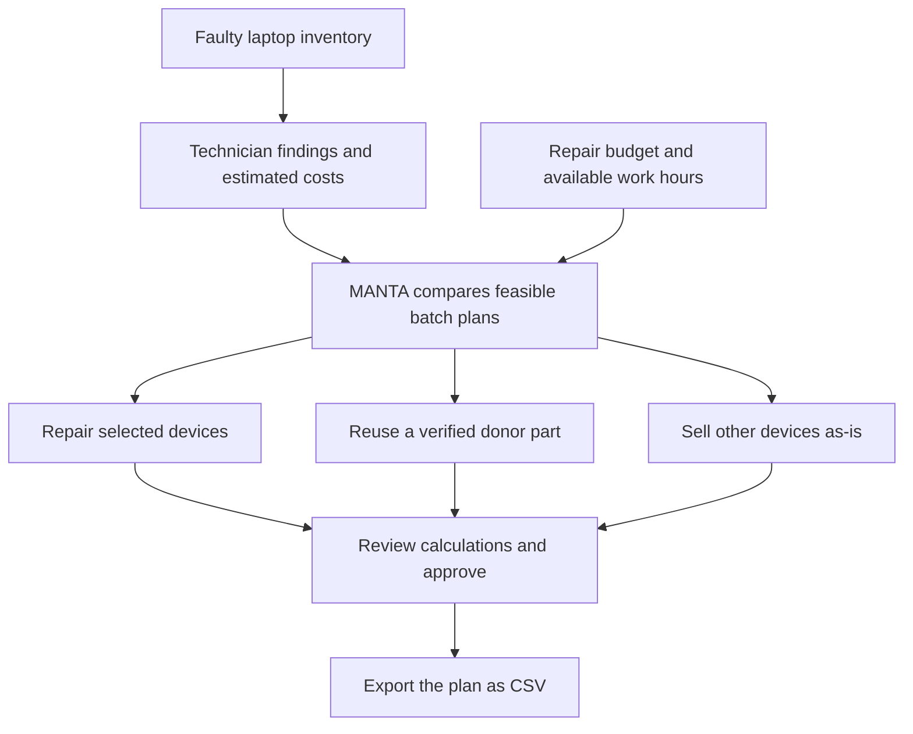

# MANTA

**Turn a batch of faulty laptops into a costed recovery plan.**

MANTA helps laptop refurbishers answer one practical question:

> With the money and technician time available, which laptops should we repair, sell as-is, or use as parts donors?

[Open the hosted MVP](https://manta-recovery.icyhinny9.chatgpt.site) · [MVP plan](PLAN.md)

The hosted preview is private and requires an authorised ChatGPT sign-in. You can also run the project locally.

## How it works

Imagine you own five faulty laptops, but have only ₹6,500 for repairs. Some repairs add more value than others. A laptop that is too expensive to repair may still contain a healthy part that can restore another device.

MANTA compares decisions across the whole batch instead of treating each laptop independently.



**Donor parts are not free value.** Removing RAM from one laptop can reduce its resale value. MANTA accounts for that loss and prevents the same donor from also being repaired in the selected plan. A technician must confirm component health and compatibility.

## Sample result

The app starts with five editable sample devices, a **₹6,500 repair budget**, and **8 technician hours**.

| Decision | Estimated net recovery |
| --- | ---: |
| Sell all five devices as-is | ₹21,500 |
| Follow the recommended plan | ₹36,000 |
| Additional recovery over selling all as-is | **₹14,500** |

The sample plan uses **₹5,900 in repair spending** and **5.5 technician hours**:

- Repair the ThinkPad T480 and ThinkPad X270.
- Repair the Latitude 5490 using healthy RAM from the Latitude 5480.
- Retain the Latitude 5480's remaining donor value.
- Sell the EliteBook 840 G5 as-is.

These are **illustrative estimates, not measured results or guaranteed profit**. Recovery values account for the entered repair and selling/warranty allowances, but exclude acquisition cost and overhead. They assume successful repairs and sales.

## Using the workspace

| Screen | What you do |
| --- | --- |
| Overview | See the current batch, estimated recovery, and next steps. |
| Inventory | Add, edit, remove, and search devices; record technician findings and estimated economics. |
| Market evidence | Save dated supplier quotes, resale asking prices, or completed-sale observations with source links. |
| Recovery planner | Set budget and labour limits, configure one verified donor match, and compare the recommended allocation. |
| Plan review | Inspect each decision, approve the plan locally, and export a CSV. |

Evidence records do not automatically change device estimates. Review the source, then update the relevant values in Inventory. Asking prices are not proof of completed-sale prices.

## Run locally

Prerequisite: a modern Node.js installation with support for ES modules and the built-in test runner, plus a modern browser. No dependency installation is required.

```bash
git clone https://github.com/nitya-goyal/MANTA.git
cd MANTA
npm start
```

Open [http://127.0.0.1:4173](http://127.0.0.1:4173).

Run the optimiser checks:

```bash
npm test
```

The six tests cover budget and time feasibility, donor accounting, zero-resource behaviour, invalid donor matches, an empty batch, and the effect of increasing the budget.

## How the optimiser calculates value

| Route | Calculation |
| --- | --- |
| Repair | Expected resale − parts − labour − selling/warranty allowance |
| Sell as-is | Entered net as-is proceeds |
| Donate a part | Entered residual value after removing the component |
| Whole-batch uplift | Planned net recovery − sell-all-as-is baseline |

The engine enumerates feasible repair/sell combinations for **up to 12 devices**, with an optional single donor match. It chooses the greatest estimated total recovery within the repair budget and technician-hour limits; ties favour lower spending.

Budget covers parts and labour. Selling/warranty allowances reduce recovery separately. Donor removal consumes the configured time; any removal labour charge must be included in the recipient's labour estimate. A donor match replaces the recipient's full required part.

This is a **deterministic planning engine**, not an AI diagnosis or a guarantee that a component is compatible.

## Project structure

```text
dist/
  index.html       Application shell
  style.css        Responsive workspace styling
  app.mjs          Screens, forms, persistence, and CSV export
  engine.mjs       Sample data and batch optimiser
server.mjs         Local static server
tests.mjs          Optimiser tests
PLAN.md            MVP scope and acceptance criteria
.openai/hosting.json  Hosted Site configuration
```

The app uses HTML, CSS, and browser JavaScript with no application framework or runtime package dependencies. Node.js serves local development and runs tests.

## Current status and limitations

**Implemented:** editable sample inventory, manual market evidence, constrained optimisation, one verified donor match, local approval, and CSV export.

**Not connected yet:** live TinyFish research, OCR, application user accounts, shared server persistence, billing, and workshop integrations. The hosted sign-in gate controls access to the preview; it does not provide shared application data.

- All application state is saved in the current browser's `localStorage`, not a shared database. It does not sync across browsers, devices, or local/hosted origins.
- Clear the `manta-v1` localStorage entry to reset the sample. Export anything you want to retain first.
- Approving a plan records a local decision. It does not purchase parts or dispatch work. Editing planning inputs invalidates approval.
- The MVP supports one donor relationship per batch, not a general multi-component compatibility graph.
- No API keys or secrets belong in this static client.

## Next steps

1. Add server-side TinyFish research for supplier and resale evidence, with dated source records and human review.
2. Add authenticated workshop accounts and durable shared storage.
3. Expand technician-verified compatibility records and donor allocation.
4. Track actual repair and resale outcomes to compare estimates with results.

The intended AI workflow gathers and explains evidence; deterministic calculations remain responsible for comparing costs and constraints.
