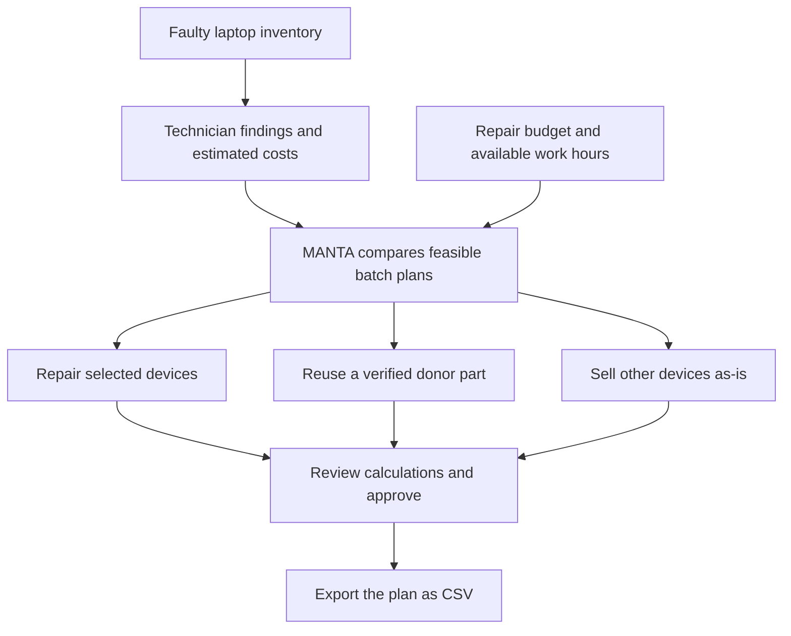

# MANTA

**Turn a batch of faulty laptops into a costed recovery plan.**

MANTA helps laptop refurbishers answer one practical question:

> With the money and technician time available, which laptops should we repair, sell as-is, or use as parts donors?

[Open the live demo](https://nitya-goyal.github.io/MANTA/) · [Run locally](#run-locally) · [MVP plan](PLAN.md)

The live demo is public and requires no sign-in. For local development, keep the terminal running while using the app; closing the server makes the localhost link unavailable.

## Showcase

[Start the guided demo](https://nitya-goyal.github.io/MANTA/?demo=1#overview) · [Three-minute showcase plan](SHOWCASE.md) · [Project workbook](https://docs.google.com/spreadsheets/d/1oj8FATKj8CYzhGJNuoylcd8ZvrJUCBWpSEDQVZoAVKk/edit#gid=427612516)

The guided demo uses a temporary sample workspace and preserves your saved batch. Refresh resets the sample; Exit returns to your regular workspace. The Drive workbook is maintained separately and retains its existing access permissions.

## How it works

Imagine you own five faulty laptops, but have only ₹6,500 for repairs. Some repairs add more value than others. A laptop that is too expensive to repair may still contain a healthy part that can restore another device.

MANTA compares decisions across the whole batch instead of treating each laptop independently.



**Donor parts are not free value.** Removing RAM from one laptop can reduce its resale value. MANTA accounts for that loss and prevents the same donor from also being repaired in the selected plan. A technician must confirm component health and compatibility.

## Sample result

The app starts with five editable sample devices, a **₹6,500 repair budget**, and **8 technician hours**.

| Decision | Estimated net recovery |
| --- | ---: |
| Sell all five devices as-is | ₹21,500 |
| Follow the recommended plan | ₹36,000 |
| Additional recovery over selling all as-is | **₹14,500** |

The sample plan uses **₹5,900 in repair spending** and **5.5 technician hours**:

- Repair the ThinkPad T480 and ThinkPad X270.
- Repair the Latitude 5490 using healthy RAM from the Latitude 5480.
- Retain the Latitude 5480's remaining donor value.
- Sell the EliteBook 840 G5 as-is.

These are **illustrative estimates, not measured results or guaranteed profit**. Recovery values account for the entered repair and selling/warranty allowances, but exclude acquisition cost and overhead. They assume successful repairs and sales.

## Using the workspace

| Screen | What you do |
| --- | --- |
| Overview | Compare planned recovery with selling everything as-is, then open the next step directly. |
| Inventory | Search and filter devices by suggested route; edit findings and costs, or undo an accidental removal. |
| Market evidence | Save dated supplier quotes, resale asking prices, or completed-sale observations with source links. |
| Recovery planner | Try budget presets or enter your own limits; configure and verify one donor match. |
| Plan review | Inspect each decision, acknowledge the review before approving locally, and export a CSV. |

Evidence records do not automatically change device estimates. Review the source, then update the relevant values in Inventory. Asking prices are not proof of completed-sale prices.

On small screens, device tables become labelled cards and all five navigation sections remain visible. Removals offer Undo for 15 seconds, until another data change is made. Changing a donor pair or editing either device clears its compatibility confirmation so the technician can review it again.

## Run locally

Prerequisite: a modern Node.js installation with support for ES modules and the built-in test runner, plus a modern browser. No dependency installation is required.

```bash
git clone https://github.com/nitya-goyal/MANTA.git
cd MANTA
npm start
```

Open [http://127.0.0.1:4173](http://127.0.0.1:4173).

Run the optimiser checks:

```bash
npm test
```

The planner tests cover budget and time feasibility, donor accounting, zero-resource behaviour, invalid donor matches, an empty batch, and the effect of increasing the budget.

## How the optimiser calculates value

| Route | Calculation |
| --- | --- |
| Repair | Expected resale − parts − labour − selling/warranty allowance |
| Sell as-is | Entered net as-is proceeds |
| Donate a part | Entered residual value after removing the component |
| Whole-batch uplift | Planned net recovery − sell-all-as-is baseline |

The engine enumerates feasible repair/sell combinations for **up to 12 devices**, with an optional single donor match. It chooses the greatest estimated total recovery within the repair budget and technician-hour limits; ties favour lower spending.

Budget covers parts and labour. Selling/warranty allowances reduce recovery separately. Donor removal consumes the configured time; any removal labour charge must be included in the recipient's labour estimate. A donor match replaces the recipient's full required part.

The planning engine uses **deterministic calculations**. Technicians remain responsible for diagnosis and compatibility checks.

## Project structure

```text
dist/
  index.html       Application shell
  style.css        Responsive workspace styling
  refinements.css  Readability, workflow, and mobile layouts
  app.mjs          Screens, forms, persistence, and CSV export
  workspace.mjs    Dashboard comparison, filters, and guided review
  engine.mjs       Sample data and batch optimiser
server.mjs         Local static server
tests.mjs          Optimiser tests
PLAN.md            MVP scope and acceptance criteria
```

The app uses HTML, CSS, and browser JavaScript with no application framework or runtime package dependencies. Node.js serves local development and runs tests.

## Deployment

The GitHub Pages workflow tests the planner and publishes only the application files in `dist/` after each push to `main`. Source documentation and local deployment settings are not part of the published artifact. GitHub Pages hosts the browser application; a future live research integration will require a separate server endpoint.

## Current status and limitations

**Implemented:** editable sample inventory, manual market evidence, constrained optimisation, one verified donor match, local approval, and CSV export.

**Not connected yet:** live research, OCR, hosted accounts, billing, and workshop integrations. Local workshop accounts and shared SQLite persistence are available in the backend prototype.

- In the public demo, application state is saved in the current browser's `localStorage`, not a shared database. It does not sync across browsers, devices, or local/hosted origins.
- Clear the `manta-v1` localStorage entry to reset the sample. Export anything you want to retain first.
- Approving a plan records a local decision. It does not purchase parts or dispatch work. Editing planning inputs invalidates approval.
- The MVP supports one donor relationship per batch, not a general multi-component compatibility graph.
- No API keys or secrets belong in this static client.

## Next steps

1. Add server-side TinyFish research for supplier and resale evidence, with dated source records and human review.
2. Add authenticated workshop accounts and durable shared storage.
3. Expand technician-verified compatibility records and donor allocation.
4. Track actual repair and resale outcomes to compare estimates with results.

The planned research integration will gather source-backed market evidence for human review. The optimiser will continue to compare costs and constraints using deterministic calculations.

MANTA uses a custom manta-ray logo and an optional Manta Guide with screen-specific workshop tips. The guide runs locally without an API or subscription.


## Local shared workshop prototype

Requires Node.js 22.13 or newer (Node 22 uses experimental built-in SQLite). Run `npm run workshop` and open http://127.0.0.1:4174. The server binds only to loopback and serves the frontend and API together. `npm start` still runs the standalone demo on port 4173.

1. Download a JSON workspace backup if you want to transfer a demo batch.
2. Choose **Create / join workshop**. Create a workshop with an email and a unique password of at least 12 characters, or enter a teammate's invitation code. New workshops begin empty.
3. Edit inventory or restore a backup. Changes are an in-memory draft until **Save to workshop** is clicked.
4. Use **Load latest** to retrieve a teammate's changes. Conflicting revisions are rejected; back up your draft before loading the latest version. There is no automatic merge.
5. Owners can generate a single-use invitation valid for 24 hours. Share it privately. Members can read and save the workshop but cannot issue invitations.
6. After reload, use **Resume session** to load the saved workspace. Sign out discards unsaved draft changes after confirmation.

The database is `data/manta.sqlite` and is excluded from Git. Stop the server before copying the entire `data/` directory for a database backup. JSON workspace backups contain inventory, evidence and planning limits; they do not contain accounts or invitations. Restoring a JSON backup clears plan approval for review.

Passwords use salted scrypt hashes. Sessions use hashed random tokens with HttpOnly, SameSite cookies and a seven-day expiry; writes require a matching Origin. Queries are parameterized and workshop access comes from the authenticated user's membership. Workspace saves record an audit event and enforce a revision check. `npm test` covers account isolation, invitation reuse, session invalidation, restart persistence, conflicting writes and malformed data.

This is a local prototype, not a deployed authentication service. Public hosting, TLS configuration, email verification, password recovery, member removal, production rate limiting, database migration tooling and operational backups remain to be implemented. GitHub Pages publishes only the demo; it cannot run this backend. No paid services or API integrations are configured.
